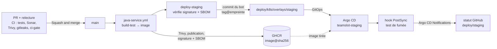

# Déploiement continu (CD)

Ce document décrit ce qui se passe entre une PR et le staging : le pipeline complet, le statut de déploiement sur GitHub et le retour arrière (SCRUM-113), la signature des images (SCRUM-104), la SBOM (SCRUM-105) et le test de fumée (SCRUM-99).

## Le pipeline en un coup d'œil



1. **PR** : relue par une autre personne ; la CI (tests, SonarCloud, Trivy, gitleaks) doit être verte (`ci-gate`).
2. **Fusion sur `main`** : le workflow du service (`<service>.yml`, qui appelle `java-service.yml`) construit et teste.
3. **Job `image`** : image construite, scannée par Trivy, publiée sur GHCR, **signée** (cosign) et accompagnée de sa **SBOM** signée.
4. **Job `deploy-staging`** : vérifie la signature et la SBOM, puis le bot écrit `tag@empreinte` dans `deploy/k8s/overlays/staging/kustomization.yaml` (commit `chore(deploy): staging <service> -> <commit>`).
5. **Argo CD** voit ce commit et synchronise le namespace `staging`.
6. **Test de fumée** (hook `PostSync`) : santé et refus sans jeton.
7. **Statut GitHub** `deploy/staging` sur le commit du bot : en cours, réussi ou échoué.

## Voir un déploiement (SCRUM-113)

- **Sur GitHub** : dans l'historique de `main` (onglet « Commits »), le commit `chore(deploy): staging <service> -> <commit>` porte une icône : point jaune (synchronisation en cours), coche verte (déployé, test de fumée réussi) ou croix rouge (échec). Cliquer dessus affiche le statut `deploy/staging`.
- Le message du commit du bot donne le commit du service déployé.
- **Détail** : Argo CD (application `teamslot-staging`, accès Tailscale, voir `docs/cluster.md`) et `kubectl logs job/smoke-test -n staging`.
- **Pas de statut** sur un commit du bot : le cluster était éteint (Argo CD n'a pas encore synchronisé), ou la notification n'est pas configurée (voir « Mise en place » ci-dessous).

## Revenir en arrière

Le staging suit `main` (GitOps) : on revient en arrière **par Git**, jamais à la main dans le cluster (Argo CD annulerait la modification, `selfHeal`).

```bash
git checkout main && git pull
git log --oneline -10                 # repérer le commit fautif (celui du service, pas celui du bot)
git checkout -b fix/revert-<commit>
git revert <commit>
git push -u origin fix/revert-<commit>
```

PR, relecture, fusion : la CI republie l'image de la version précédente, le bot met à jour le staging, Argo CD redéploie et relance le test de fumée. Si seul le déploiement est en cause (le code est bon), on peut aussi faire un `git revert` du commit du bot `chore(deploy)` : le tag précédent revient directement, sans reconstruire d'image.

## Mise en place du statut GitHub (SCRUM-113)

Argo CD Notifications (inclus dans Argo CD) écrit le statut avec une **application GitHub** dédiée :

- **teamslot-argocd-status** : seule permission « Commit statuses : Read and write », installée uniquement sur `teamslot-app/teamslot`. Elle ne peut ni lire ni modifier le code ;
- sa **clé privée** est dans le secret `argocd-notifications-secret` (namespace `argocd`), **scellé** : `deploy/argocd/notifications-secret-sealed.yaml`. Jamais en clair dans le dépôt, ni dans un message ;
- la configuration (`deploy/argocd/notifications-cm.yaml`) et l'abonnement de l'application (`deploy/argocd/staging.yaml`, annotations `notifications.argoproj.io/subscribe.*`) ne contiennent aucun secret.

Étapes (une seule fois) :

1. Un propriétaire de l'organisation crée l'application GitHub (permission ci-dessus, sans webhook), l'installe sur le dépôt et génère une clé privée (`.pem`), gardée hors du dépôt.
2. Il remplace `A_REMPLACER_APP_ID` et `A_REMPLACER_INSTALLATION_ID` dans `notifications-cm.yaml` (ces identifiants ne sont pas secrets).
3. Il scelle la clé, sans jamais l'écrire dans un fichier du dépôt :

```bash
kubectl create secret generic argocd-notifications-secret -n argocd \
  --from-file=github-privateKey=chemin/vers/cle.pem --dry-run=client -o yaml \
  | kubeseal --cert pub-cert.pem --format yaml > deploy/argocd/notifications-secret-sealed.yaml
```

4. Amira relit puis applique dans `argocd`. Le secret vide créé à l'installation d'Argo CD doit être supprimé avant (sinon Sealed Secrets refuse de le remplacer) :

```bash
kubectl delete secret argocd-notifications-secret -n argocd
kubectl apply -n argocd -f deploy/argocd/notifications-secret-sealed.yaml
kubectl apply -n argocd -f deploy/argocd/notifications-cm.yaml
kubectl apply -n argocd -f deploy/argocd/staging.yaml
```

Rien n'est créé au niveau du cluster (pas de ClusterRole) : une ConfigMap, un SealedSecret et l'annotation de l'application, tous dans `argocd`. Si Argo CD a été installé avec Helm, la configuration va plutôt dans les valeurs du chart (`notifications.cm`), sinon un `helm upgrade` l'effacerait.


## Signature des images (SCRUM-104)

### Ce qui se passe

Dans `.github/workflows/java-service.yml` (toutes les images Java : gateway, identity, venue, match, payment, service-template) :

1. le job `image` construit l'image, la scanne avec Trivy, la publie sur GHCR, puis la **signe avec cosign en mode sans clé** : GitHub donne au job une identité OIDC, et Sigstore délivre un certificat de quelques minutes à cette identité. Aucune clé privée n'est stockée dans le dépôt ni dans les secrets. La permission `id-token: write` n'est donnée **qu'à ce job** ;
2. on signe **l'empreinte** (`@sha256:…`), jamais un tag : un tag peut être déplacé vers une autre image, une empreinte non ;
3. le job `deploy-staging` **vérifie la signature** avant d'écrire quoi que ce soit dans `deploy/k8s/overlays/staging`. L'identité exigée est celle du workflow `java-service.yml` de la branche `main` de ce dépôt. Si l'image n'est pas signée, ou si elle est signée par une autre identité, le job échoue et rien n'est déployé ;
4. le bot écrit ensuite l'image sous la forme `tag@empreinte` (tag = SHA du commit, pour la lisibilité). Kubernetes tire donc exactement l'image qui vient d'être vérifiée.

À savoir : la signature est enregistrée dans le journal public de Sigstore (Rekor). Elle y mentionne le dépôt et le workflow, qui sont déjà publics.

### Vérifier une image à la main

L'empreinte d'une image déployée se lit dans `deploy/k8s/overlays/staging/kustomization.yaml` (champ `digest`), ou dans les logs du Job `smoke-test`. Avec Docker Desktop, sans rien installer :

```bash
docker run --rm ghcr.io/sigstore/cosign/cosign:v3.0.6 verify \
  --certificate-oidc-issuer https://token.actions.githubusercontent.com \
  --certificate-identity https://github.com/teamslot-app/teamslot/.github/workflows/java-service.yml@refs/heads/main \
  ghcr.io/teamslot-app/payment-service@sha256:<empreinte>
```

- Signature valide : cosign affiche « The cosign claims were validated » et les détails du certificat (JSON), puis renvoie le code 0.
- Image non signée (par exemple une image publiée avant SCRUM-104) : erreur « no signatures found », code différent de 0.
- Identité différente : erreur sur l'identité du certificat, code différent de 0.

Si la vérification échoue alors que l'image vient bien de notre CI, lancer une fois la même commande avec `--certificate-identity-regexp '.*'` à la place de `--certificate-identity …`, pour lire l'identité exacte dans le certificat. Puis remettre l'identité stricte : `'.*'` accepte n'importe quel signataire et ne doit jamais rester dans le workflow.

### Suite prévue

Refuser dans le cluster les images non signées (politique d'admission, par exemple Kyverno) : ticket séparé, Sprint 3. Le front (SCRUM-114) a son propre workflow : il faudra y ajouter les mêmes étapes.

## SBOM de chaque image (SCRUM-105)

### Ce qui se passe

Dans le job `image` de `java-service.yml`, juste après la signature :

1. Trivy produit la **SBOM** de l'image au format CycloneDX (`sbom.cdx.json`) : la liste de tous ses composants, paquets Alpine et jars Java, avec leur version ;
2. `cosign attest` attache cette SBOM à **l'empreinte** de l'image, signée par la même identité que l'image (le workflow `java-service.yml` de `main`) ;
3. une copie est gardée **90 jours** comme artefact du run (`sbom-<service>-<commit>`, en bas de la page du run, rubrique « Artifacts ») ;
4. `deploy-staging` refuse de déployer une image **sans SBOM signée** (`cosign verify-attestation`).

### Quelle image déployée contient une bibliothèque ?

Quand une faille est publiée (par exemple lz4-java, CVE-2026-106451), depuis la racine du dépôt à jour (`git pull`), Docker Desktop lancé :

```bash
deploy/sbom/chercher-composant.sh lz4-java
```

Le script lit les empreintes déployées dans `deploy/k8s/overlays/staging/kustomization.yaml`, vérifie la SBOM signée de chacune et affiche, par service, `CONTIENT` avec la version (`pkg:maven/at.yawk.lz4/lz4-java@1.11.4`) ou `absent`. Aucune image n'est reconstruite ni téléchargée. Une image publiée avant SCRUM-105 n'a pas de SBOM : relancer son workflow sur `main` (« Run workflow ») pour en produire une.

### Lire la SBOM complète d'une image

```bash
docker run --rm ghcr.io/sigstore/cosign/cosign:v3.0.6 verify-attestation --type cyclonedx \
  --certificate-oidc-issuer https://token.actions.githubusercontent.com \
  --certificate-identity https://github.com/teamslot-app/teamslot/.github/workflows/java-service.yml@refs/heads/main \
  ghcr.io/teamslot-app/payment-service@sha256:<empreinte> > attestation.json
sed -n 's/.*"payload":"\([^"]*\)".*/\1/p' attestation.json | head -n 1 | base64 -d > sbom-payment.json
```

`sbom-payment.json` contient la SBOM (champ `predicate`). On peut aussi télécharger l'artefact du run.

## Test de fumée après chaque déploiement (SCRUM-99)

### Ce qu'il vérifie

Après chaque synchronisation du staging, Argo CD lance le Job `smoke-test` (hook `PostSync`, fichier `deploy/k8s/base/smoke-test.yaml`, script `deploy/k8s/base/smoke-test.sh`). Le Job :

1. affiche les **tags d'image déployés** (un par service, copiés depuis les Deployment par `deploy/k8s/overlays/staging/smoke-test-versions.yaml`) ;
2. vérifie que `/actuator/health` répond `UP` pour gateway, identity-service, venue-service, match-service, payment-service et service-template (jusqu'à environ 5 minutes par service) ;
3. vérifie que des routes protégées appelées **sans jeton** répondent `401` : la passerelle (`/api/v1/matches`) et, en direct, venue-service (SCRUM-87), match-service et payment-service.

Le Job n'utilise aucun jeton ni secret, ne monte aucun secret, et n'a pas accès à l'API Kubernetes (`automountServiceAccountToken: false`).

### Pourquoi dans le cluster

Le staging tourne sur le PC d'Amira (k3d, ADR-003) : GitHub Actions ne peut pas le joindre. Le hook tourne donc dans le cluster, à côté des services. Aucun port à ouvrir, aucun secret à donner à GitHub.

### Version déployée

Argo CD ne lance un hook `PostSync` qu'une fois **toutes** les ressources synchronisées et en bonne santé : chaque Deployment a alors fini de déployer l'image dont le tag (le SHA du commit, écrit par la CI) est affiché en tête des logs du Job. Amélioration prévue : faire renvoyer ce SHA par la route de version de chaque service (aujourd'hui elle renvoie `app.version` et demande un jeton).

### Où regarder

- **Argo CD** : application `teamslot-staging`. Le Job apparaît comme hook ; une synchronisation dont le test échoue est en échec.
- **kubectl** (accès en lecture au namespace `staging`) :

```bash
kubectl get job smoke-test -n staging
kubectl logs job/smoke-test -n staging
```

Chaque contrôle affiche une ligne `OK` ou `KO`, puis `RÉSULTAT`. Le Job précédent est supprimé au lancement du suivant (`BeforeHookCreation`) : on lit toujours le dernier test.

### Que faire si le test échoue

1. Lire les lignes `KO` dans `kubectl logs job/smoke-test -n staging`.
2. **Santé pas UP** : regarder le service concerné (`kubectl get pods -n staging`, `kubectl logs deploy/<service> -n staging --tail=100`). Causes fréquentes : base de données, Kafka, migration Flyway, variable d'environnement manquante.
3. **401 attendu, autre code reçu** : 🔒 incident de sécurité possible, la vérification du JWT ne protège plus la route. `200` = route ouverte sans authentification ; `404` ou `5xx` = route ou service cassé. Prévenir la référente sécurité, et revenir en arrière si la route est ouverte.
4. **Retour arrière** : `git revert` du commit fautif sur `main` ; Argo CD redéploie la version précédente et relance le test.
5. Noter le constat dans le ticket Jira du changement.

### Tester le script avant de fusionner

Avec l'accès limité au staging : uniquement des objets nommés `postsync-test-…`, sans secret monté, et on ne supprime que les siens. Copier le Job (`smoke-test.yaml`) sous le nom `postsync-test-smoke`, sans les annotations Argo CD, avec une ConfigMap `postsync-test-smoke` créée depuis le script, puis :

```bash
kubectl apply -n staging -f postsync-test-smoke.yaml
kubectl wait --for=condition=complete --timeout=600s job/postsync-test-smoke -n staging
kubectl logs job/postsync-test-smoke -n staging
kubectl delete -n staging -f postsync-test-smoke.yaml
```

## Image du front (SCRUM-114)

Le front a son propre workflow, `.github/workflows/web.yml` (ce n'est pas une application Maven : il n'appelle pas `java-service.yml`) :

- **PR** : `npm ci`, lint, tests et build (`build-test`), puis construction de l'image et scan Trivy sans publication (`image-scan`).
- **`main`** : l'image `ghcr.io/teamslot-app/web` est publiée, signée (cosign sans clé) avec sa SBOM, puis `deploy-staging` vérifie la signature et écrit `tag@empreinte` dans `deploy/k8s/overlays/staging/kustomization.yaml`, avec le même garde-fou que les services Java.
- L'identité de signature exigée est celle de ce workflow : `.../workflows/web.yml@refs/heads/main` (et non `java-service.yml`).
- Le groupe de concurrence `deploy-staging` est partagé avec les services Java : un seul commit du robot à la fois sur l'overlay.
- Les jobs `image` et `deploy-staging` sont une copie de ceux de `java-service.yml` ; les extraire dans un workflow réutilisable est prévu séparément.
- Le conteneur nginx se configure avec `API_UPSTREAM` (docker-compose : `http://gateway:8080` ; Kubernetes : `http://gateway`) et se lance en lecture seule avec des volumes inscriptibles (uid/gid 101) sur `/tmp`, `/var/cache/nginx` et `/etc/nginx/conf.d`.
